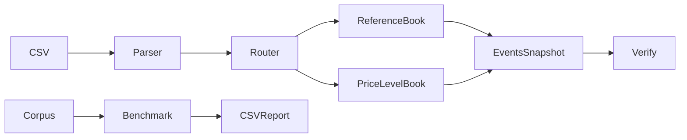

# AsterBook — Deterministic Matching & Replay Engine

[](https://github.com/kadirr1343/AsterBook/actions/workflows/ci.yml)

A C++23 order-matching laboratory with deterministic replay, independent reference-model validation, and reproducible performance experiments. Learn container ownership, iterator validity, price-time priority and honest measurement through a runnable CLI.

The vector reference and map/list/hash price-level engine independently implement the same contract. Golden cases plus per-command differential tests compare actual events, state, depth and conservation; Release checks remain active. Real corpora, measurements and metadata live in [benchmarks/results](benchmarks/results/). This is a single-writer synthetic matching lab, with no real brokerage connection.

## Engineering highlights

| Area | Implementation |
|---|---|
| Language and build | C++23, GCC 13+, target-based CMake, Ninja, reproducible presets |
| Order matching | Integer ticks, price-time priority, FIFO, GTC/IOC, cancellation |
| Ownership | RAII, value snapshots, stable map/list locators, noncopyable books |
| Correctness | Independent models, golden expectations, per-command differential checks |
| Performance | Fresh-state throughput and separate latency passes, recorded corpora and SHA-256 provenance |
| Delivery | CTest, Debug/Release, ASan/UBSan, Ubuntu GitHub Actions workflow |

## Quickstart
Run from the project root. Verified locally on Ubuntu 24.04 x86_64, GCC 13.3/libstdc++, CMake 3.28.3, Ninja and Python 3.12.3. Minimum CMake 3.25 (preset schema 6); GCC 13+ with a configure-time std::expected check. No downloaded C++ dependencies. Python standard library is required for integration/report tests; clang-format-18 only for formatting. On Ubuntu, packages are `g++-13 cmake ninja-build python3 clang-format-18`.

```sh
git clone https://github.com/kadirr1343/AsterBook.git
cd AsterBook
cmake --preset release
cmake --build --preset release
ctest --preset release
./build/release/asterbook demo
./build/release/asterbook replay --input examples/sweep.csv --engine price-level --events out/events.csv --snapshot out/book.csv
./build/release/asterbook verify --input examples/sweep.csv
./build/release/asterbook generate --seed 42 --count 10000 --scenario mixed --output out/workload.csv
./build/release/asterbook bench --input out/workload.csv --engine both --output out/bench.csv
python3 tools/report.py --bench out/bench.csv --output out/report.html
```

Outputs create parent directories. Open out/report.html in a browser. Bare `bench` writes CSV; the report marks platform unknown unless a sibling .meta.json is supplied. For full recorded metadata and eight experiments, run `python3 tools/experiments.py`; use `--output out/experiments` to preserve the checked-in baseline.

## Scope
| Supported | Deliberately excluded |
|---|---|
| Buy/Sell limit, GTC/IOC, partial/full fill, sweep | Market/FOK/amend/replace |
| Active-ID cancellation and reuse per symbol | Network/broker connectivity |
| Per-symbol acceptance/trade counters, integer ticks | Floating-point prices and clock FIFO |
| Owned snapshots, L2 depth, top/count queries | Iterator-returning public queries |
| Strict CSV replay, verify, generation, benchmark | Crash-safe WAL, durability and recovery |
| Typed rejection and fail-stop operational errors | Thread safety, production HFT claims |

A matching engine executes against resting orders. A market-data book reconstructs an external venue's published state. A strategy chooses actions. This repository implements the first for synthetic input, not the latter two. Tick display metadata is external; ticks are not assumed to be cents.



## Real demo
The executable prints the full canonical event ledger. Key rows from the captured [demo output](examples/demo.txt):

```text
5,1,1,0,0,0,0,0,0,3       # rejected duplicate (kind 5, error 3)
1,1,4,1,4,1,1,100,5,0    # first FIFO maker
1,1,4,2,4,2,2,100,7,0    # second FIFO maker
1,1,4,3,4,3,3,101,2,0    # sweep, partial maker 3
3,1,3,0,3,0,0,101,2,0    # remaining 2 cancelled
4,1,5,0,5,0,0,99,3,0     # IOC remaining 3 expired
1,BUY,98,1,2,2,6          # final snapshot: reused ID, acceptance 6
```
Comments above are annotations, not input CSV syntax. [CSV v1](docs/csv.md) documents all numeric event codes.

## Validation and limitations
```sh
cmake --preset debug
cmake --build --preset debug
ctest --preset debug
cmake --preset sanitize
cmake --build --preset sanitize
ctest --preset sanitize
./build/release/asterbook_tests --extended
```
Local ASan+UBSan passes with `ASAN_OPTIONS=detect_leaks=0 UBSAN_OPTIONS=halt_on_error=1 ctest --preset sanitize`. Full local LeakSanitizer failed because the execution environment uses ptrace; leak detection is **not verified locally**. CI keeps leak detection enabled. Debug/Release and sanitizer checks, CLI error paths and allocation-failure injection are recorded in [progress](docs/progress.md). Extended testing is 100 seeds × 10,000 commands; on failure, seed/index and replayable prefix are emitted.

Snapshot, depth, top and count queries copy/scan O(N); cancellation does not. Near arithmetic limits admission is conservative. An exception during apply poisons the engine, with no strong rollback; reuse is refused. No fuzzing, profiling or multi-compiler verification is claimed. The first hosted CI run passed Debug, Release, formatting, CLI/benchmark smoke and ASan/UBSan with leak detection enabled: [verified run](https://github.com/kadirr1343/AsterBook/actions/runs/37989181624). CI targets Ubuntu 24.04/GCC 13; see the live Actions status for hosted execution results.

## Explore and publish
[Contract](docs/semantics.md) · [Architecture/costs](docs/architecture.md) · [Benchmark method](docs/benchmarking.md) · [Turkish learning guide](docs/learning-tr.md) · [Interview notes](docs/interview-notes-tr.md) · [Portfolio](docs/portfolio.md) · [Release checklist](docs/release-checklist.md) · [Türkçe README](README.tr.md).

MIT; holder taken from local Git identity. Repository: https://github.com/kadirr1343/AsterBook. The CI badge reflects the actual workflow status; historical local measurements remain available with provenance. See the publication checklist before tagging a release.

## Measured example

| 6,000 commands, seed 42 | Reference ops/s | Price-level ops/s | Raw data |
|---|---:|---:|---|
| add-only | 5,230 | 6,873,210 | [CSV](benchmarks/results/add-only-6000-128.csv) |
| cancel-heavy | 21,372,100 | 12,725,300 | [CSV](benchmarks/results/cancel-heavy-6000-128.csv) |
| mixed | 12,075,300 | 8,140,480 | [CSV](benchmarks/results/mixed-6000-128.csv) |
| sweep-heavy | 15,256,300 | 11,145,800 | [CSV](benchmarks/results/sweep-heavy-6000-128.csv) |

Median of five repeats on the recorded host, not a portable guarantee. Mixed/cancel/sweep have small active books. [Method, metadata and reproduction](docs/benchmarking.md).
