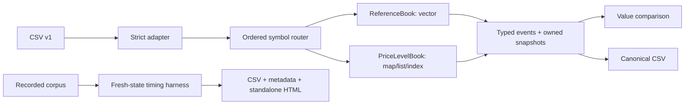

# Architecture

[types.hpp](../include/asterbook/types.hpp) defines units, commands, events, ordering and externally specified validation. [book.hpp](../include/asterbook/book.hpp) defines noncopyable Book ownership and APIs. Matching, cancellation and mutation are independent in [reference.cpp](../src/reference.cpp) and [price_level.cpp](../src/price_level.cpp). Common depth aggregation is a query helper, not a matching oracle; golden tests check price/FIFO and expected fills separately.

Core calls contain no time, stdout, file or parser access. [io.cpp](../src/io.cpp) is an adapter, CLI is [main.cpp](../apps/main.cpp), timing is [harness.cpp](../benchmarks/harness.cpp). They are linked into the same library for a small build, but engine source files have no adapter dependencies. `std::span<const Command>` borrows a corpus during a call; returned Replay/events/snapshot own their values. Multi-symbol replay stores `unique_ptr<Book>` in a sorted map: objects stay in place, canonical symbol order is stable, and destruction is automatic.

N = active orders, L = price levels, K = matched makers. Reference admission/search O(N), vector erase O(N), add remainder full sort O(N log N), repeated erases on sweep up to O(KN). Price-level duplicate lookup average O(1), worst O(N); new level O(log L); FIFO insertion O(1) plus node/hash allocation. Matching K nodes has expected O(K) hash work and amortized iterator erases, with worst-case hash collisions O(KN). Cancellation uses average O(1) hash search, O(1) list erase and amortized O(1) map erase by iterator; individual tree rebalancing can take O(log L). No price lookup scan. Snapshot/depth/top/count APIs currently copy/scan O(N), not constant-time cached queries. Reference invariant deliberately includes an O(N²) duplicate scan; diagnostics are excluded from timing.

Each map/list/hash node adds allocator and pointer costs; vector has contiguous storage but invalidates positions on insert/erase/sort. A retained result vector makes events observable, at an O(commands + events) memory cost in benchmarks. No production exchange routing, market-data book reconstruction, strategy, networking or concurrency.
